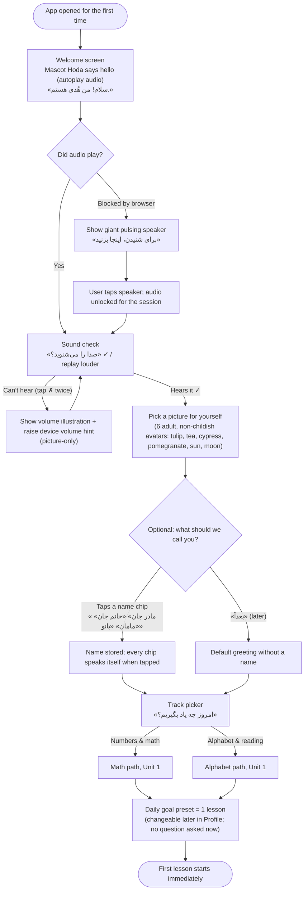
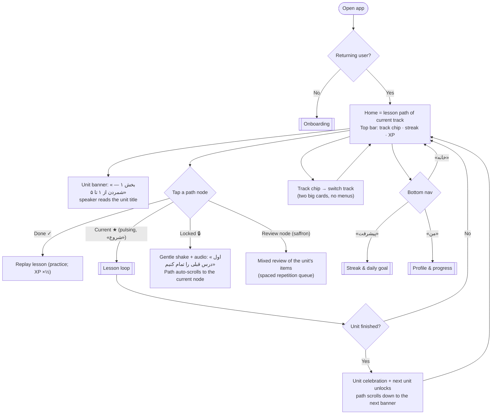
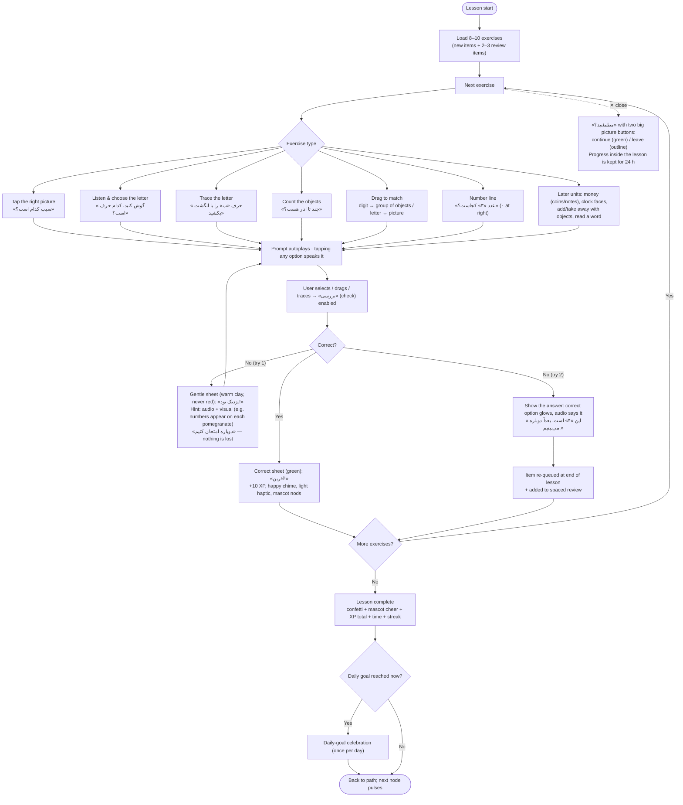
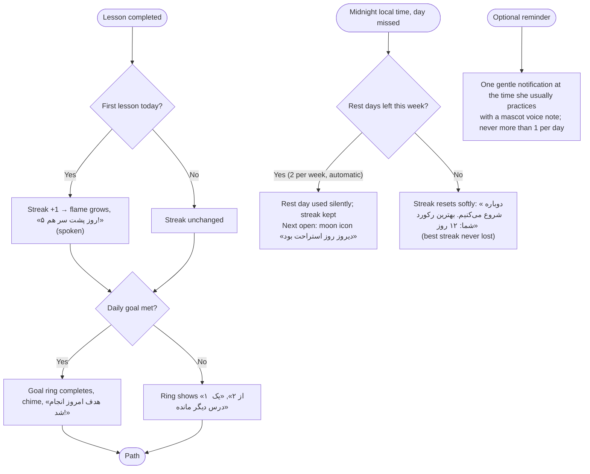
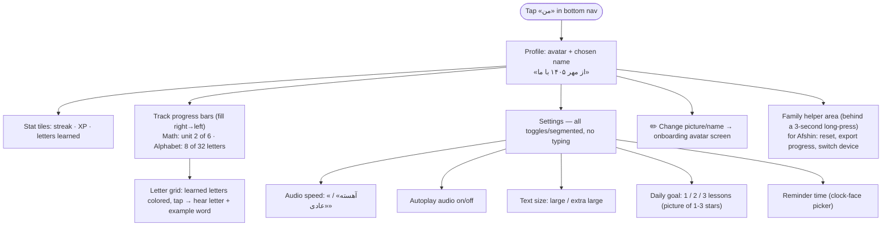

# persian-learn — User flows

All flows are written for an RTL, Persian-only UI. Labels below are in English for engineers; quoted strings are the actual Persian UI copy. Each diagram is also rendered to `flows/*.png` (generated with `@mermaid-js/mermaid-cli` from this file; regenerate with `node tools/render-flows.js`).

Principles that every flow obeys:
- **No typing anywhere.** Every input is a tap, a drag, or a trace.
- **Audio first.** Every screen autoplays its prompt once; a large speaker button replays it; a slower replay is always available.
- **One task per screen.**
- **No penalties.** No lives or hearts. A mistake leads to a hint and a retry, never to losing something.

## 1. Onboarding (first launch)

## 2. Home and the lesson path

Path layout: the path starts at the top and winds downward in an S curve. The first zig goes toward the right side, which is the reading start in RTL. Nodes alternate between center, right, center, and left. Each unit has about 5 lessons and 1 review node.

## 3. The lesson loop (question types, feedback, gentle retry)

**Gentle alternative to hearts (assumed):** there are no lives or energy. A wrong answer costs nothing. The first miss gives a hint and a retry. The second miss shows and speaks the answer, and that item comes back later in the lesson and again in review. The progress bar never moves backward. XP is earned only for correct answers, and a correct answer on the retry still earns full XP. Mistakes are visible to the system (they feed spaced repetition) but carry no punishment the learner can see.

## 4. Streak and daily goal

## 5. Profile and progress

